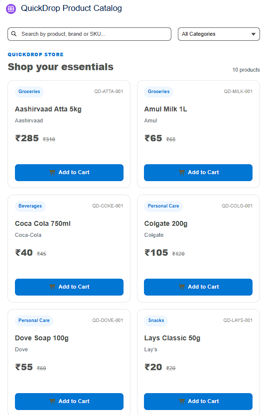
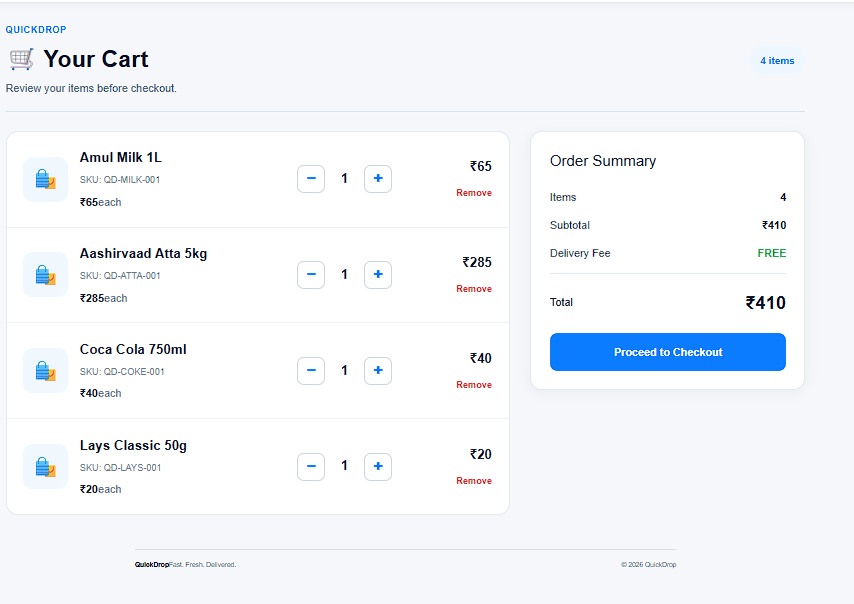
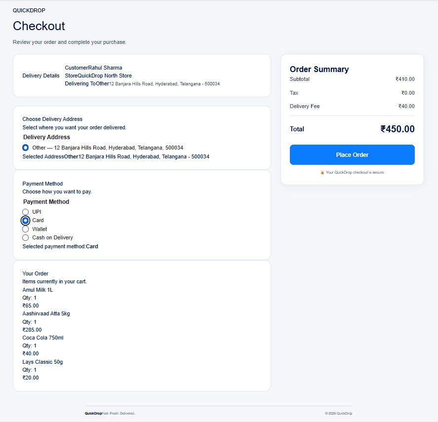
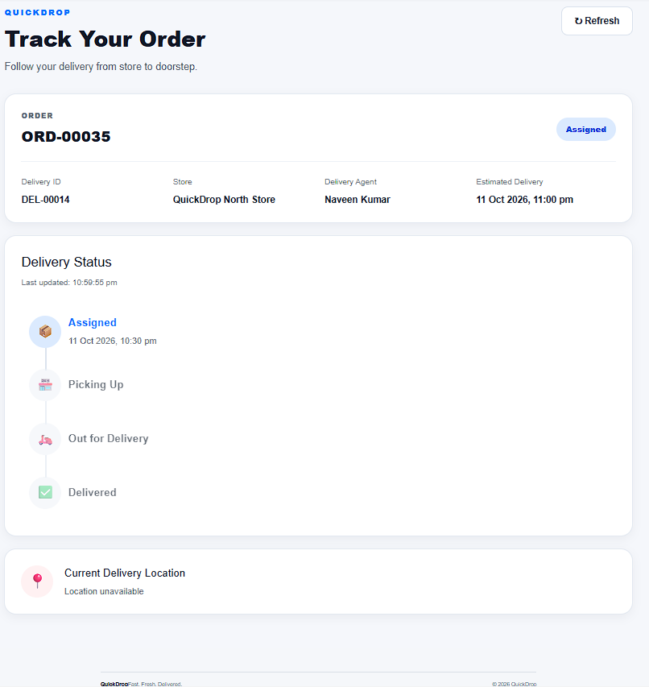

# QuickDrop — Salesforce Quick-Commerce & Delivery Tracker

A Salesforce-based quick-commerce application built to manage product discovery, shopping carts, customer orders, payments, inventory, store operations, and delivery tracking.

QuickDrop demonstrates how Salesforce Admin and Developer capabilities can be combined to build an end-to-end business application using custom objects, automation, Apex, Lightning Web Components (LWC), and asynchronous integration patterns.

## Project Overview

QuickDrop simulates a quick-commerce platform where customers can browse products, add items to their cart, place orders, and track delivery progress. The Salesforce platform manages the underlying business records, automation, and application logic.

**Project type:** Salesforce Development / Quick-Commerce  
**Platform:** Salesforce  
**Primary technologies:** Apex, Lightning Web Components, SOQL, Salesforce Flows  
**Development tools:** Visual Studio Code, Salesforce CLI, Git, GitHub

## Key Features

### Customer Storefront
- Browse products in a Lightning Web Component-based catalog.
- Search products by name, brand, or SKU.
- Filter products by category.
- Add products to the cart.
- Increase, decrease, or remove cart items.
- View cart quantities and totals.

### Checkout and Order Management
- Retrieve customer and store context.
- Select a delivery address and payment method.
- Create customer orders and order line items.
- Calculate order totals using Salesforce automation.
- Maintain order and payment status.

### Delivery Tracking
- Assign deliveries to delivery agents.
- Track delivery status and relevant timestamps.
- Maintain delivery status history.
- View delivery details, estimated arrival time, and available location information.
- Automatically refresh delivery tracking information in the customer interface.

### Inventory and Store Operations
- Organize stores by geographic zones.
- Maintain product and store inventory records.
- Automate inventory updates.
- Generate low-stock alerts.
- Support store and delivery management through Salesforce permissions and access controls.

### Integration Prototype
- Send delivery creation requests through an Apex HTTP callout.
- Use a Named Credential for endpoint configuration.
- Process responses from an external delivery API.
- Record integration outcomes in a custom integration-log object.
- Implement Queueable Apex and scheduled retry processing for eligible failures.

The external delivery integration requires a configured endpoint and a compatible external API. Its successful end-to-end operation depends on that external service being available and correctly configured.
## Application Screenshots

### Product Catalog


### Shopping Cart


### Checkout


### Delivery Tracking


## Technology Stack

| Technology | Purpose |
|---|---|
| Salesforce Platform | Application platform and business data |
| Apex | Server-side business logic and API callouts |
| SOQL | Query Salesforce records |
| Lightning Web Components | Interactive customer-facing UI |
| Salesforce Flows | Record automation and business processes |
| Queueable Apex | Asynchronous integration processing |
| Scheduled Apex | Retry processing for eligible failures |
| Custom Objects and Fields | QuickDrop business data model |
| Permission Sets and Sharing | Access management |
| Salesforce CLI | Deployment and testing |
| VS Code | Development environment |
| Git and GitHub | Source control and project management |

## Salesforce Data Model

QuickDrop uses custom Salesforce objects to represent its business processes.

| Object API Name | Purpose |
|---|---|
| `Zone__c` | Geographic service zones |
| `Store__c` | Store information |
| `Category__c` | Product categories |
| `Product__c` | QuickDrop product records |
| `Store_Inventory__c` | Store-level inventory |
| `Customer__c` | Customer records |
| `Customer_Address__c` | Customer delivery addresses |
| `Cart__c` | Shopping carts |
| `Cart_Item__c` | Products and quantities in carts |
| `Customer_Order__c` | Customer orders |
| `Order_Line_Item__c` | Individual order items |
| `Payment__c` | Payment records |
| `Delivery_Agent__c` | Delivery agent records |
| `Delivery__c` | Delivery assignments and tracking |
| `Delivery_Status_Log__c` | Delivery status history |
| `Delivery_Route__c` | Delivery route information |
| `Low_Stock_Alert__c` | Low-inventory alerts |
| `QuickDrop_Integration_Log__c` | External integration requests and outcomes |

The data model uses lookups and relationships to connect customers, stores, products, orders, payments, and deliveries.

## Salesforce Automation

The project includes 11 active Salesforce Flows for business automation:

1. Order Line Item Pricing
2. Delivery Status History
3. Order Total Calculation
4. Inventory Stock Update
5. Low Stock Alert
6. Order Confirmation
7. Delivery Assignment
8. Delivery Status Timestamps
9. Payment Status Sync
10. Order Completion
11. Payment Amount Auto Fill

These flows help automate record updates, calculations, status transitions, inventory operations, and delivery-related processes.

## Apex Components

The project includes Apex controllers and services for the customer storefront, shopping cart, checkout, order processing, and delivery tracking.

Key classes include:

- `QuickDropStoreContextController`
- `QuickDropProductController`
- `QuickDropCartController`
- `QuickDropCheckoutController`
- `QuickDropOrderTrackerController`
- `QuickDropDeliveryTrackerController`
- `QuickDropOrderService`
- `QuickDropOrderLineItemTriggerHandler`
- `QuickDropDeliveryApiService`
- `QuickDropDeliveryApiQueueable`
- `QuickDropDeliveryRetryScheduler`

The project also contains Apex test classes and reusable test-data utilities.

## Lightning Web Components

The customer-facing interface is built using Lightning Web Components.

| Component | Responsibility |
|---|---|
| `quickDropStoreHome` | Main storefront navigation and customer context |
| `quickDropProductCatalog` | Product catalog, search, category filtering, and Add to Cart |
| `quickDropCart` | Cart items, quantity changes, removal, and totals |
| `quickDropCheckout` | Checkout and order placement |
| `quickDropOrderTracker` | Customer order tracking |
| `quickDropDeliveryTracker` | Delivery status and tracking information |

## Security and Access Management

The Salesforce configuration includes role hierarchy, organization-wide sharing settings, permission sets, and record-access controls for different operational responsibilities.

Security considerations include:
- Restricting access to customer and transaction data.
- Configuring permissions for store and delivery management.
- Applying appropriate record-sharing and field-access settings.
- Validating record ownership and user authorization when exposing customer-specific data.

Actual access depends on the deployed metadata, the user's assigned permissions, and the target org's configuration.

## Integration Architecture

The delivery integration prototype uses the following pattern:

1. An order is submitted for external delivery processing.
2. Apex constructs a JSON request.
3. A Named Credential supplies the configured endpoint.
4. The external API returns an HTTP response.
5. Salesforce records the request outcome in `QuickDrop_Integration_Log__c`.
6. Queueable Apex processes integration requests asynchronously.
7. The retry scheduler can reprocess eligible failed requests.

The request includes an idempotency key. Duplicate-request protection depends on the external service implementing and honoring that key.

## Application Workflow

The main customer journey is:

**Browse Products → Add to Cart → Update Cart → Checkout → Create Order → Process Payment Record → Assign Delivery → Track Delivery**

Salesforce Flows and Apex support the associated record updates and business rules.

## Testing

The project includes Apex test classes for order processing, triggers, integration callouts, Queueable Apex, and retry scheduling.

In the latest reported local test run, **15 tests passed with a 100% pass rate**. This describes the test pass rate, not 100% Apex code coverage.

Run the local Apex test suite using Salesforce CLI:

```bash
sf apex run test --target-org QuickDropOrg --test-level RunLocalTests --result-format human --wait 30
```

Additional end-to-end validation should cover the actual customer storefront, cart, checkout, order creation, payment records, and delivery tracking in the target Salesforce org.

## Prerequisites

- Salesforce CLI installed.
- Visual Studio Code with Salesforce Extension Pack.
- Access to a Salesforce development org.
- Git installed for source control.

## Setup and Deployment

### 1. Clone the repository

```bash
git clone https://github.com/vinay00865-dev/QuickDrop.git
cd QuickDrop
```

### 2. Authorize your Salesforce development org

```bash
sf org login web --alias QuickDropOrg
```

Complete the authentication flow in your browser.

If you use another alias, replace `QuickDropOrg` in the following commands with that alias.

### 3. Deploy the project metadata

Review the source and target org configuration before deployment.

```bash
sf project deploy start --target-org QuickDropOrg --source-dir force-app
```

### 4. Configure the environment

After deployment:

- Verify required custom objects, fields, flows, Apex classes, and Lightning components.
- Assign the appropriate permission sets to the test user.
- Configure the required Named Credential if testing the external delivery integration.
- Create or import the required sample records.
- Verify the customer, store, product, inventory, and delivery relationships.

Some settings and records may require separate configuration in the target org. A successful metadata deployment alone does not guarantee that all integrations or business workflows are ready to use.

### 5. Run tests

```bash
sf apex run test --target-org QuickDropOrg --test-level RunLocalTests --result-format human --wait 30
```

### 6. Open the org

```bash
sf org open --target-org QuickDropOrg
```

## Future Enhancements

- Extend the customer storefront with additional usability and accessibility improvements.
- Add more comprehensive integration monitoring and operational dashboards.
- Expand automated test coverage and regression testing.
- Strengthen security testing for customer-specific records.
- Add an Agentforce-powered customer support experience when an appropriately enabled Salesforce org is available.

## Learning Outcomes

This project provides practical experience with:

- Salesforce data modeling and relationships.
- Apex controllers, triggers, services, and testing.
- SOQL and record-processing patterns.
- Record-triggered automation using Salesforce Flows.
- Lightning Web Components and component event handling.
- Permission sets, sharing, and access management.
- HTTP callouts, Named Credentials, Queueable Apex, and scheduled retries.
- Salesforce CLI deployment, testing, and Git-based source control.

## Repository

GitHub: https://github.com/vinay00865-dev/QuickDrop

---

**QuickDrop** — A Salesforce quick-commerce and delivery management project demonstrating end-to-end business workflows, automation, and application development.
